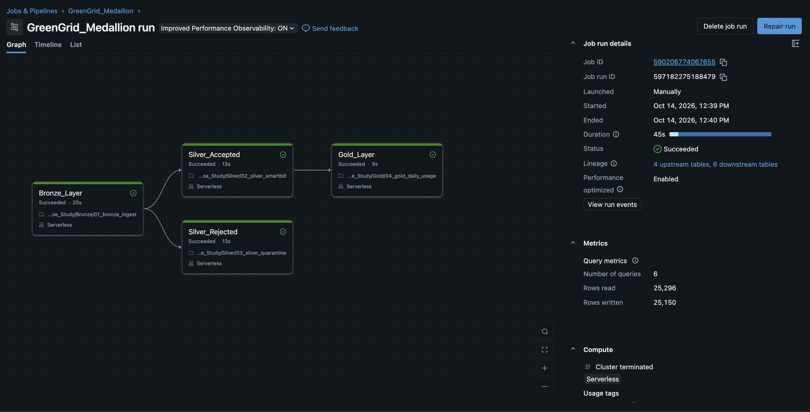
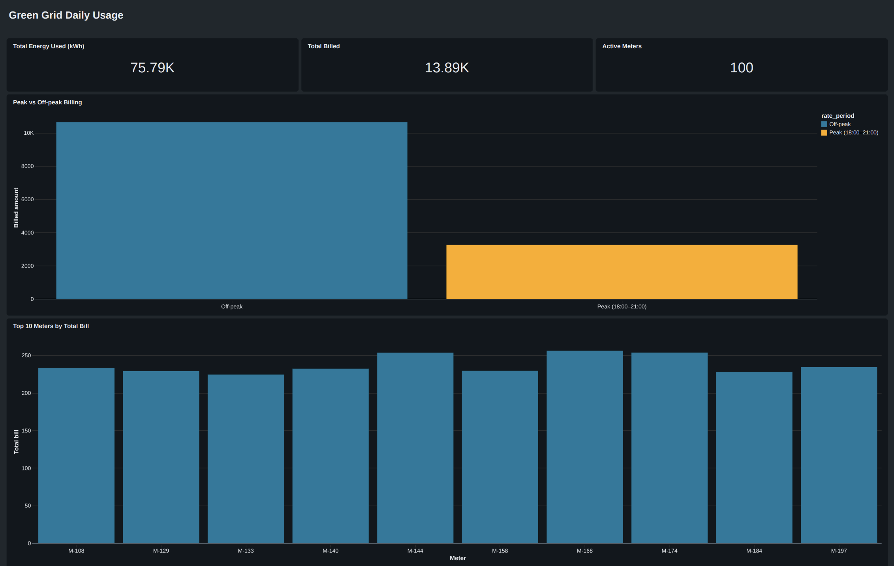

# GreenGrid Smart Pricing Pilot — Medallion Data Pipeline

## 📋 Project Overview

This project implements a **Medallion Architecture** (Bronze → Silver → Gold) on **Databricks** and **Delta Lake** for **GreenGrid**, a fictitious smart-energy startup. The pipeline replaces manual, spreadsheet-based billing with an automated, auditable workflow for a **Time-of-Use (ToU) pricing pilot** covering 100 residential meters (`M-101` to `M-200`) over December 2025.

Raw meter telemetry is ingested, validated, billed with a peak-hour multiplier, anonymised with SHA-256, aggregated per meter, and published to a Databricks AI/BI dashboard. The whole flow is orchestrated by a single Databricks Job.

---

## 🎯 Business Problem

The pilot gates GreenGrid's Series B and the Q3 rollout to 50,000 homes, but the existing process had three compounding failures:

- **Unclean Telemetry**: Negative readings and phantom 9,000 kWh spikes (62 anomalies in the month) reached invoices because Excel could not filter them
- **Manual Logic Gap**: Peak-hour multipliers were applied inconsistently, causing silent revenue leakage during the most expensive windows
- **PII Exposure**: Customer emails sat in plain text, joined directly to usage data on shared drives
- **Slow Billing**: About 72 hours of manual preparation per cycle (target: under 60 minutes, automated)

---

## 🏗️ Architecture Overview

### Core Components

1. **Source Data**: Meter readings (JSON), customer PII (CSV), and pricing plans (CSV), stored in a Unity Catalog Volume
2. **Processing Layer**: Databricks serverless compute with PySpark
3. **Storage**: Delta tables in Unity Catalog (`databricksbootcamp.greeengridcasestudy`)
4. **Medallion Layers**: Bronze → Silver (accepted / rejected) → Gold
5. **Orchestration**: Databricks Job `GreenGrid_Medallion`
6. **Consumption**: Databricks AI/BI Dashboard
7. **Version Control**: GitHub

### Medallion Flow

```
                              ┌──────────────────┐
                         ┌──> │  SILVER ACCEPTED │ ──> ┌────────────┐
┌──────────────┐         │    │  clean, billed,  │     │    GOLD    │
│    BRONZE    │ ────────┤    │  hashed PII      │     │ per-meter  │
│ raw ingestion│         │    └──────────────────┘     │ aggregates │
└──────────────┘         │                             └────────────┘
                         │    ┌──────────────────┐
                         └──> │  SILVER REJECTED │
                              │  quarantine      │
                              └──────────────────┘
```

**Design rule:** ingest first, quarantine second, hash and bill third, aggregate last. Reversing the order would let a bad reading (for example `-10.0`) reach billing.

---

## 📊 Data Pipeline Implementation

### 📥 Source Data (`Dataset/`)

| File | Description |
|------|-------------|
| `meter_readings.json` | 12,474 readings (`meter_id`, `timestamp`, `kwh`, `status`) across 100 meters, Dec 2025 |
| `customer_pii.csv` | 100 rows: `MeterID`, `PlanID`, `CustomerEmail` |
| `pricing_plans.csv` | `P1` Saver at $0.10/kWh, `P2` Eco-Green at $0.25/kWh |

---

### 🥉 Bronze Layer (`Bronze/01_bronze_ingest.ipynb`)

**Purpose**: Raw ingestion with full traceability, no business logic

**Key Features**:
- Reads the three source files from the Unity Catalog Volume
- Applies an explicit schema to the JSON readings (`kwh` double, `timestamp` timestamp)
- Adds `ingested_at` and a `run_id` (notebook widget, defaults to `manual`) to every table

**Tables Created**:
- `bronze_pii`
- `bronze_plans`
- `bronze_readings`

---

### 🥈 Silver Layer — Accepted (`Silver/02_silver_smartbill.ipynb`)

**Purpose**: Quality firewall, billing logic, and PII protection

**Key Features**:
- **Validation**: Keeps readings with `0 <= kwh <= 100`
- **Enrichment**: Left-joins readings to customers (by meter) and then to pricing plans (by plan)
- **Time-of-Use Billing**: Doubles the base rate during peak hours
- **Anonymisation**: Replaces `CustomerEmail` with `CustomerHash = sha2(email, 256)` and drops the raw email

**Billing Logic**:
```python
FinalRate   = BasePricePerKwh * 2   # peak hours (evening window)
            = BasePricePerKwh       # otherwise
Bill_Amount = FinalRate * kwh
```

Example (from the case-study spec): meter `M-101` (plan `P2`, $0.25) reading 3.0 kWh at 19:30 → rate 0.25 × 2 = **0.50** → bill = 0.50 × 3.0 = **$1.50**.

**Table Created**: `silver_smartbill`

---

### 🚫 Silver Layer — Rejected (`Silver/03_silver_quarantine.ipynb`)

**Purpose**: Isolate invalid readings for review instead of billing them or silently dropping them

**Rejection Rules**:

| Condition | `Rejected_Reason` |
|-----------|-------------------|
| `kwh < 0` | `negative_reading` |
| `kwh > 100` | `over_ceiling` |

**Result**: 62 readings quarantined (31 negative, 31 over-ceiling), 12,412 clean readings billed. Email is hashed here too, so no raw PII exists outside Bronze.

**Table Created**: `quarantine_radings`

---

### 🥇 Gold Layer (`Gold/04_gold_daily_usage.ipynb`)

**Purpose**: Business-ready usage and billing aggregates for reporting

**Key Features**:
- Labels each reading `peak` or `offpeak`
- Pivots per meter into peak and off-peak energy and billing
- Fills missing periods with 0 and rounds to 2 decimals
- Computes `total_kwh` and `total_bill`

**Table Created**: `gold_daily_usage`

| Column | Description |
|--------|-------------|
| `meter_id` | Meter identifier |
| `peak_kwh` / `offpeak_kwh` | Energy by rate period |
| `peak_bill` / `offpeak_bill` | Billed amount by rate period |
| `total_kwh` / `total_bill` | Totals per meter |
| `ingested_at`, `run_id` | Lineage columns |

---

## ⚙️ Orchestration

The pipeline runs as a single Databricks Job, **`GreenGrid_Medallion`**, on serverless compute.

| Task | Notebook | Depends on | Duration |
|------|----------|------------|----------|
| `Bronze_Layer` | `01_bronze_ingest` | — | 20s |
| `Silver_Accepted` | `02_silver_smartbill` | Bronze_Layer | 13s |
| `Silver_Rejected` | `03_silver_quarantine` | Bronze_Layer | 13s |
| `Gold_Layer` | `04_gold_daily_usage` | Silver_Accepted | 9s |

Silver Accepted and Silver Rejected run **in parallel**; Gold waits only for Silver Accepted.

**Latest run**: Succeeded in 45s, 6 queries, 25,296 rows read, 25,150 rows written.


*GreenGrid_Medallion job run graph*

---

## 📈 Dashboard

An AI/BI dashboard (**Green Grid Daily Usage**) is built directly on the Gold table:

| Widget | Source | Insight |
|--------|--------|---------|
| Total Energy Used (kWh) | `gold_daily_usage` | 75.79K kWh |
| Total Billed | `gold_daily_usage` | 13.89K |
| Active Meters | `gold_daily_usage` | 100 |
| Peak vs Off-peak Billing | `peak_vs_offpeak` dataset | Peak hours bring in about 3.3K of the 13.89K billed (≈23%) |
| Top 10 Meters by Total Bill | `top10_meters` dataset | Highest bills are in the 225–255 range |


*Green Grid Daily Usage dashboard*

The dashboard definition is exported in `Green Grid Daily Usage.lvdash.json`.

---

## ✅ Acceptance Criteria Mapping

| Criterion | Implementation |
|-----------|----------------|
| **Completeness** | Bronze ingests all three sources and tags every row with `ingested_at` and `run_id` |
| **Integrity** | Out-of-range readings routed to quarantine with a `Rejected_Reason` |
| **Governance** | Silver stores only `CustomerHash` (SHA-256); the raw email is dropped |
| **Peak Logic** | Evening readings carry a doubled rate in `FinalRate` and flow into `Bill_Amount` |

---

## 🛠️ Technology Stack

| Component | Technology |
|-----------|-----------|
| **Data Platform** | Databricks (Serverless) |
| **Storage Format** | Delta Lake |
| **Processing Engine** | Apache Spark (PySpark) |
| **Catalog & Storage** | Unity Catalog (tables and Volume) |
| **Orchestration** | Databricks Jobs |
| **Consumption** | Databricks AI/BI Dashboards |
| **Version Control** | GitHub |
| **Languages** | Python (PySpark), SQL |

---

## 🚀 How to Run

1. Upload the three files from `Dataset/` to the Unity Catalog Volume `/Volumes/databricksbootcamp/greeengridcasestudy/greeengridcasestudyvolume`
2. Import the four notebooks into your Databricks workspace
3. Run them in order (`01` → `02` and `03` → `04`), or create a Job with the dependency graph shown above
4. Open the dashboard and point its datasets at `gold_daily_usage`

> Catalog, schema and volume names are spelled exactly as they appear in the notebooks (`greeengridcasestudy`). Each notebook accepts an optional `run_id` widget for lineage.

---

## 📁 Project Structure

```
green_grid_case_study/
├── Bronze/
│   └── 01_bronze_ingest.ipynb       # Raw ingestion
├── Silver/
│   ├── 02_silver_smartbill.ipynb    # Validation, billing, SHA-256
│   └── 03_silver_quarantine.ipynb   # Rejected readings
├── Gold/
│   └── 04_gold_daily_usage.ipynb    # Per-meter aggregates
├── Dataset/
│   ├── meter_readings.json
│   ├── customer_pii.csv
│   └── pricing_plans.csv
├── Images/
│   ├── green_grid_dashboard.png
│   └── job_execution.png
├── Green Grid Daily Usage.lvdash.json   # Dashboard definition
├── Green_Grid_Case_Study.pdf            # Original case study brief
└── README.md
```

---

## 🔧 Implementation Highlights

### Quality Firewall Before Billing
```python
df_readings = (
    spark.read.table("bronze_readings")
    .filter((col("kwh") >= 0) & (col("kwh") <= 100))
)
```

### PII Protection
```python
.withColumn("CustomerHash", sha2(col("CustomerEmail"), 256))
.drop("CustomerEmail")
```

### Peak / Off-peak Pivot
```python
df_silver.withColumn("period", when(is_peak, "peak").otherwise("offpeak"))
         .groupBy("meter_id")
         .pivot("period", ["peak", "offpeak"])
         .agg(sum("kwh"), sum("Bill_Amount"))
```

---

## 🎓 Learning Outcomes

1. **Medallion Architecture** with a parallel quarantine branch
2. **Data quality firewalls** that quarantine bad records instead of billing them
3. **Privacy by design** using one-way SHA-256 hashing, which keeps joins possible without exposing emails
4. **Business-rule implementation** (Time-of-Use pricing) in PySpark
5. **Job orchestration** with task dependencies and parallel branches
6. **AI/BI dashboards** built on a governed Gold table

---

## 🔮 Known Limitations & Future Enhancements

- **Peak window boundary**: The spec defines peak as 18:00 up to (not including) 21:00; the notebooks currently use `Hour <= 21`. The dataset has no readings in hour 21, so results are unaffected, but the condition should be `Hour < 21`
- **Daily granularity in Gold**: Gold aggregates per meter for the whole month. Grouping by `date(timestamp)` (and plan) would make it truly daily and enable trend and plan charts
- **Quarantine boundary**: The brief rejects `0` and `100` as well; the code rejects only `< 0` and `> 100`
- **Safe re-runs**: Replace full-table `overwrite` with date-partitioned writes using `replaceWhere`
- **Alerting**: Add a Databricks Alert on the quarantine count and a failure notification on the Job
- **Scheduling**: Trigger the Job on a schedule instead of manually
- **Scale**: At 100,000+ homes, switch to incremental ingestion (for example Auto Loader) rather than full re-reads

---

## 📝 Conclusion

The GreenGrid pipeline turns noisy IoT readings into trustworthy, anonymised bills in under a minute. Bad data is quarantined with a reason, peak pricing is applied consistently, and no raw email reaches analytics. The result gives GreenGrid an automated, auditable foundation for the 50,000-home rollout.

---
